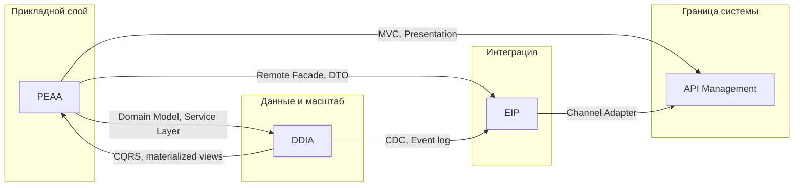

# Корпус знаний patterns (точка входа для ИИ)

## Подключение (MDpedia)

# AI Hints — инструкции для парсеров и эмбеддингов

## Как парсить MDpedia

### 1. Фронтматтер
- Каждый `.md` файл начинается с YAML фронтматтера между `---`
- Обязательные поля для концептов: `title`, `skill`, `level`
- Обязательные поля для скиллов: `name`, `version`, `inputs`, `outputs`

### 2. Семантические ссылки
- Формат: `[[filename]]` или `[[filename#section|text]]`
- Тип связи можно указать в round скобках: `(type:prerequisite)`
- Все ссылки должны быть разрешены до реальных путей файлов

### 3. Chunk Strategy
- `semantic-paragraphs` — нарезать по абзацам, сохраняя смысл
- `headings` — нарезать по заголовкам `##`
- `fixed-size` — фиксированные чанки с перекрытием 10%

### 4. Embedding Target
- Секция `## Ядро для ИИ (Embedding Target)` — приоритетная для векторизации
- Содержит сжатое изложение фактов без воды
- Максимальная длина определяется в `embeddings.max_tokens`

## Как строить граф

1. Спарсить все `[[links]]` из файлов
2. Разрешить имена файлов относительно `content/`
3. Построить направленный граф зависимостей
4. Добавить рёбра из `relations` фронтматтера
5. Экспортировать в `graph/links.json`

## Как использовать скиллы

1. При запросе пользователя определить намерение
2. Найти релевантные скиллы по тегам и описанию
3. Проверить `inputs` — есть ли необходимые данные
4. Выполнить алгоритм из скилла
5. Вернуть `outputs`


## MANIFEST

См. `corpus/MANIFEST.json`.

## Индекс библиотеки

# Библиотека архитектурных паттернов

Синтез четырёх источников в `books-md/` (см. [README](../README.md)).

| Каталог | Источник | Записей | Фокус |
|---------|----------|---------|--------|
| [peaa-patterns.md](./peaa-patterns.md) | Fowler, *PEAA* | 51 | Домен, ORM, веб, распределение, сеансы |
| [ddia-patterns.md](./ddia-patterns.md) | Kleppmann, *DDIA* | ~45 концепций | Данные, репликация, транзакции, потоки |
| [eip-patterns.md](./eip-patterns.md) | Hohpe & Woolf, *EIP* | 65 | Интеграция сообщений |
| [api-management-patterns.md](./api-management-patterns.md) | Medjaoui et al., *Continuous API Management* | governance + lifecycle | API как продукт |
| [spring-boot-decisions.md](./spring-boot-decisions.md) | Spring Boot Reference 3.2.3 | starters + stacks | Spring Boot «когда что» |

## Карта стыков (где книги пересекаются)



## Типовые цепочки решений

### Новый микросервис с БД

1. **PEAA:** Domain Model vs Transaction Script → Service Layer → Repository/Data Mapper.
2. **DDIA:** одна БД на сервис; секционирование по ключу; репликация leader-follower; уровень изоляции.
3. **EIP:** при синхронных вызовах — Request-Reply + Message Endpoint; при событиях — Publish-Subscribe + Event Message.
4. **API:** контракт как продукт; версионирование; столпы DX и documentation.

### Интеграция legacy + SaaS

1. **EIP:** канал → адаптер → транслятор → маршрутизатор (Content-Based Router / Recipient List).
2. **DDIA:** избегать dual-write; предпочесть CDC или outbox + идемпотентный приёмник.
3. **PEAA:** Gateway, anti-corruption layer (как Service Layer + Mapper).
4. **API:** governance scheme (collaborative vs automated).

### Высокая нагрузка чтения

1. **DDIA:** реплики для чтения; кэш; материализованные представления; eventual consistency.
2. **PEAA:** Query Object, Data Transfer Object, Identity Map.
3. **EIP:** Competing Consumers, Message Queue.
4. **API:** rate limiting, visibility pillar.

## Быстрый поиск

```bash
rg -i "pattern name" library/
rg "Problem\." library/peaa-patterns.md
```

**ИИ-корпус:** [../corpus/AGENT-INDEX.md](../corpus/AGENT-INDEX.md) · **Люди (HTML):** [INDEX.html](./INDEX.html)

Скиллы агента:
- [system-design-patterns](../.cursor/skills/system-design-patterns/SKILL.md)
- [spring-boot-expert](../.cursor/skills/spring-boot-expert/SKILL.md)

## Репозиторий

# Pattern library workspace

Книги в PDF конвертированы в Markdown; из них собрана структурированная библиотека и скилл для проектирования.

## Структура

| Путь | Назначение |
|------|------------|
| `*.pdf`, `spring-boot-reference.pdf` | Исходные книги и Spring Boot Reference |
| `books-md/` | Текст после `scripts/pdf_to_md.py` (pdftotext) |
| `library/` | Каталоги паттернов, [INDEX.md](./library/INDEX.md), [INDEX.html](./library/INDEX.html) |
| `corpus/` | Точка входа для ИИ: `AGENT-INDEX.md`, `MANIFEST.json` |
| `mdpedia/` | Граф, concepts, копии скиллов (формат [MDpedia](https://github.com/isalnikov/MDpedia)) |
| `.cursor/skills/system-design-patterns/` | Скилл агента Cursor |
| `scripts/pdf_to_md.py` | Повторная конвертация PDF → MD |

## Источники

1. **Kleppmann** — *Высоконагруженные приложения* (DDIA)
2. **Fowler** — *Шаблоны корпоративных приложений* (PEAA)
3. **Hohpe & Woolf** — *Шаблоны интеграции корпоративных приложений* (EIP)
4. **Medjaoui et al.** — *Непрерывное развитие API* (Continuous API Management)
5. **Spring Boot Reference** 3.2.3 — `spring-boot-reference.pdf` → [spring-boot-decisions.md](./library/spring-boot-decisions.md)

> Файл `nepreriv_razvit.pdf` — это **Continuous API Management**, не Continuous Delivery (Humble/Farley).

## Использование

- Люди: [library/INDEX.html](./library/INDEX.html) или [library/INDEX.md](./library/INDEX.md).
- ИИ-агент (любая среда): [corpus/AGENT-INDEX.md](./corpus/AGENT-INDEX.md) → [mdpedia/graph/links.json](./mdpedia/graph/links.json) → скиллы в `mdpedia/content/skills/` или `.cursor/skills/`.
- Cursor: скиллы `system-design-patterns`, `spring-boot-expert`.

Пересборка корпуса: `python3 scripts/build-agent-corpus.py`

### Переконвертация книг

```bash
python3 scripts/pdf_to_md.py
```

## Субагенты

Каталоги в `library/` подготовлены отдельными агент-сессиями с разбором соответствующих `books-md/*.md`.
