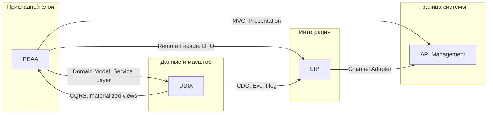

# Библиотека архитектурных паттернов

Синтез четырёх источников в `books-md/` (см. [README](../README.md)).

| Каталог | Источник | Записей | Фокус |
|---------|----------|---------|--------|
| [peaa-patterns.md](./peaa-patterns.md) | Fowler, *PEAA* | 51 | Домен, ORM, веб, распределение, сеансы |
| [ddia-patterns.md](./ddia-patterns.md) | Kleppmann, *DDIA* | ~45 концепций | Данные, репликация, транзакции, потоки |
| [eip-patterns.md](./eip-patterns.md) | Hohpe & Woolf, *EIP* | 65 | Интеграция сообщений |
| [api-management-patterns.md](./api-management-patterns.md) | Medjaoui et al., *Continuous API Management* | governance + lifecycle | API как продукт |
| [spring-boot-decisions.md](./spring-boot-decisions.md) | Spring Boot Reference 3.2.3 | starters + stacks | Spring Boot «когда что» |
| [sql/mysql-performance-patterns.md](./sql/mysql-performance-patterns.md) | Schwartz et al., *High Performance MySQL* 3rd ed. | Ch 1–11, 14, App. D | MySQL «когда что» (schema, indexes, EXPLAIN, replication) |
| [sql/sql-recipes-and-queries.md](./sql/sql-recipes-and-queries.md) | Molinaro *SQL Cookbook*; Астахова *SQL в примерах* | recipes | JOIN, агрегаты, window, pivot, иерархии |
| [sql/sql-fundamentals.md](./sql/sql-fundamentals.md) | Chapman, *Learning MySQL* (гл. 1–10) | basics | Типы, ER, DDL/DML |
| [sql/sql-transactions-and-ha.md](./sql/sql-transactions-and-ha.md) | Weikum & Vossen; Bell et al. | TX + HA | ACID, 2PC, репликация, failover, backup |

## Карта стыков (где книги пересекаются)



## Типовые цепочки решений

### Новый микросервис с БД

1. **PEAA:** Domain Model vs Transaction Script → Service Layer → Repository/Data Mapper.
2. **DDIA + sql/:** одна БД на сервис; секционирование по ключу; репликация leader-follower; уровень изоляции — см. [sql-transactions-and-ha.md](./sql/sql-transactions-and-ha.md).
3. **EIP:** при синхронных вызовах — Request-Reply + Message Endpoint; при событиях — Publish-Subscribe + Event Message.
4. **API:** контракт как продукт; версионирование; столпы DX и documentation.

### Интеграция legacy + SaaS

1. **EIP:** канал → адаптер → транслятор → маршрутизатор (Content-Based Router / Recipient List).
2. **DDIA:** избегать dual-write; предпочесть CDC или outbox + идемпотентный приёмник.
3. **PEAA:** Gateway, anti-corruption layer (как Service Layer + Mapper).
4. **API:** governance scheme (collaborative vs automated).

### Высокая нагрузка чтения

1. **DDIA:** реплики для чтения; кэш; материализованные представления; eventual consistency.
2. **PEAA:** Query Object, Data Transfer Object, Identity Map.
3. **EIP:** Competing Consumers, Message Queue.
4. **API:** rate limiting, visibility pillar.

## Быстрый поиск

```bash
rg -i "pattern name" library/
rg "Problem\." library/peaa-patterns.md
```

**ИИ-корпус:** [../corpus/AGENT-INDEX.md](../corpus/AGENT-INDEX.md) · **Люди (HTML):** [INDEX.html](./INDEX.html)

Скиллы агента:
- [system-design-patterns](../.cursor/skills/system-design-patterns/SKILL.md)
- [spring-boot-expert](../.cursor/skills/spring-boot-expert/SKILL.md)
- [sql-expert](../.cursor/skills/sql-expert/SKILL.md) · SQL: [sql/INDEX.md](./sql/INDEX.md)