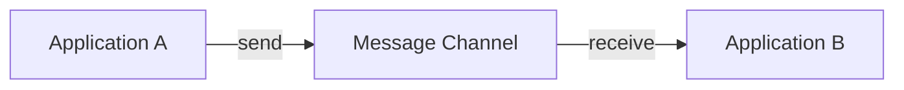
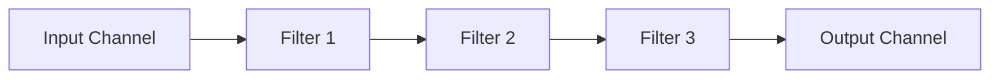
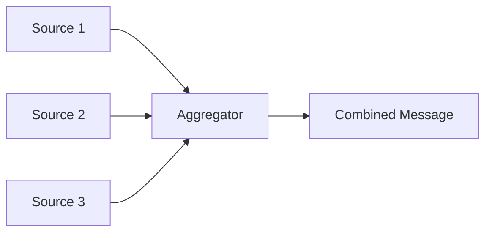

# Enterprise Integration Patterns (EIP)

Reference extracted from *Enterprise Integration Patterns* (Hohpe & Woolf, 2004) / Russian edition «Шаблоны интеграции корпоративных приложений» (2007).

**Source:** `books-md/Шаблоны интеграции корпоративных приложений.md` — Appendix A (problem statements), chapters 2–11 (solutions), Appendix B (categories and pictograms).

**Total:** 65 patterns in **8 categories** (4 integration styles + 7 messaging pattern groups; Integration Styles are architectural alternatives, not messaging-specific).

---

## 1. Integration Styles (Стили интеграции)

Architectural approaches to application integration (Chapter 2). Only **Messaging** is the basis for the patterns below.

### File Transfer

| Field | Content |
|-------|---------|
| **Icon** | — |
| **Problem** | How do you integrate and exchange data between multiple applications? |
| **Solution** | One application writes data to a shared file store; others read it. Agree on file location, naming, format (often XML), locking, and refresh frequency. Minimal coupling via the file contract only. |
| **Example** | Nightly export of orders from ERP to a CSV/XML drop folder consumed by the warehouse system. |

### Shared Database

| Field | Content |
|-------|---------|
| **Icon** | — |
| **Problem** | How do you integrate and exchange data between multiple applications? |
| **Solution** | All applications read and write the same database schema designed to satisfy every consumer. Strong consistency, but tight coupling and fragile shared schema evolution. |
| **Example** | CRM and billing both updating a single `customers` table in Oracle. |

### Remote Procedure Invocation

| Field | Content |
|-------|---------|
| **Icon** | — |
| **Problem** | How do you integrate and exchange data between multiple applications? |
| **Solution** | Expose operations as remotely callable procedures (RPC, RMI, SOAP, REST with RPC style). Synchronous, tightly coupled, requires both ends to be available. |
| **Example** | Order service calls `Inventory.reserve(sku, qty)` over HTTP/SOAP. |

### Messaging

| Field | Content |
|-------|---------|
| **Icon** | — |
| **Problem** | How do you integrate and exchange data between multiple applications? |
| **Solution** | Connect applications through message channels in a messaging system. Senders and receivers are decoupled in time and location; asynchronous, buffered, often transactional delivery. Foundation for all EIP patterns in sections 2–8. |
| **Example** | Order placed event published to a queue; fulfillment, billing, and notification subscribe without the order UI waiting. |

---

## 2. Messaging Systems (Системы обмена сообщениями)

Root patterns for message-based integration (Chapter 3).

### Message Channel

| Field | Content |
|-------|---------|
| **Icon** | — |
| **Problem** | How do you connect two applications using messaging? |
| **Solution** | Connect applications with a **Message Channel**: a logical path through the messaging system from sender to receiver. One channel per type of information; channels are designed up front and hide physical transport details. |
| **Example** | Dedicated `NEW_ORDER` queue between web shop and order processing. |

### Message

| Field | Content |
|-------|---------|
| **Icon** | — |
| **Problem** | How do you exchange data between two applications connected by a Message Channel? |
| **Solution** | Package data in a **Message** (header + body) so it can be routed, stored, and transformed independently of the sending application. |
| **Example** | JSON order payload with headers for `MessageId` and `Timestamp`. |

### Pipes and Filters

| Field | Content |
|-------|---------|
| **Icon** | — |
| **Problem** | How do you perform complex processing on a message while maintaining independence and flexibility? |
| **Solution** | Chain **Filters** (processing steps), each connected by channels. A filter reads from one channel, transforms, writes to another. Reorder or replace filters without changing endpoints. |
| **Example** | Validate → enrich tax → persist — three filters on separate channels. |

### Message Router

| Field | Content |
|-------|---------|
| **Icon** | — |
| **Problem** | How do you route a message to different processing steps depending on conditions? |
| **Solution** | Insert a **Message Router** that consumes from an input channel and sends to one or more output channels based on rules (content, headers, load, etc.). Generalizes conditional branching in a pipe-and-filter architecture. |
| **Example** | Router sends EU orders to `VAT_PROCESSING`, US orders to `DOMESTIC_SHIPPING`. |

### Message Translator

| Field | Content |
|-------|---------|
| **Icon** | — |
| **Problem** | How do you exchange messages between applications that use different data formats? |
| **Solution** | Place a **Message Translator** between endpoints to convert message structure and semantics from source to target format (including transport-level bridging). |
| **Example** | EDI X12 purchase order → internal canonical JSON at the boundary. |

### Message Endpoint

| Field | Content |
|-------|---------|
| **Icon** | — |
| **Problem** | How does an application connect to a messaging channel? |
| **Solution** | Implement a **Message Endpoint** in the application — code that sends or receives messages without leaking messaging APIs through the domain model. All application-specific messaging logic lives here. |
| **Example** | JMS `MessageProducer` / `MessageConsumer` wrapper inside the inventory service. |

---

## 3. Messaging Channels (Каналы обмена сообщениями)

Channel types and infrastructure patterns (Chapter 4).

### Point-to-Point Channel

| Field | Content |
|-------|---------|
| **Icon** | — |
| **Problem** | How can the sender guarantee that a document or command is processed by exactly one receiver? |
| **Solution** | Use a **Point-to-Point Channel** (queue): each message is consumed by a single consumer (competing consumers still mean one processing per message). |
| **Example** | Work queue for payment authorization requests. |

### Publish-Subscribe Channel

| Field | Content |
|-------|---------|
| **Icon** | — |
| **Problem** | How do you broadcast an event to all interested receivers? |
| **Solution** | Use a **Publish-Subscribe Channel** (topic): each subscriber receives a copy of every message published to the channel. |
| **Example** | `PRODUCT_UPDATED` topic notifies catalog, search index, and cache invalidation. |

### Datatype Channel

| Field | Content |
|-------|---------|
| **Icon** | — |
| **Problem** | How does the application send a message so that the receiver knows how to process it? |
| **Solution** | Dedicate separate channels per message type (or class of processing), so the channel identity implies datatype — no extra inspection required at the receiver. |
| **Example** | Separate channels `CREATE_ORDER`, `CANCEL_ORDER`, `UPDATE_ADDRESS`. |

### Invalid Message Channel

| Field | Content |
|-------|---------|
| **Icon** | — |
| **Problem** | What should you do with a message that is meaningless to the receiver? |
| **Solution** | Route unprocessable messages to an **Invalid Message Channel** for inspection, alerting, or manual correction instead of infinite redelivery or silent drop. |
| **Example** | Malformed order line items sent to `INVALID_ORDER_ITEMS`. |

### Dead Letter Channel

| Field | Content |
|-------|---------|
| **Icon** | — |
| **Problem** | What should you do with messages that cannot be delivered? |
| **Solution** | After retries expire, move undeliverable messages to a **Dead Letter Channel** for operational handling (distinct from invalid semantic content). |
| **Example** | Messages for a decommissioned service land in `DLQ.billing`. |

### Guaranteed Delivery

| Field | Content |
|-------|---------|
| **Icon** | — |
| **Problem** | How can you make sure a message is delivered even if the messaging system fails? |
| **Solution** | Persist the message before acknowledging send (transactional client, persistent store, or hand-off to the broker) so it survives crashes and can be resent. |
| **Example** | JMS persistent messages + DB outbox before `commit`. |

### Channel Adapter

| Field | Content |
|-------|---------|
| **Icon** | — |
| **Problem** | How do you connect an isolated application to the messaging system so it can send and receive messages? |
| **Solution** | Build a **Channel Adapter** that connects a non-messaging application to Message Channels — translate between the app’s API (files, DB, proprietary API) and messaging without changing the legacy core. |
| **Example** | Adapter reads new rows from `outbox_table` and publishes to `ORDERS` queue. |

### Messaging Bridge

| Field | Content |
|-------|---------|
| **Icon** | — |
| **Problem** | How do you connect multiple messaging systems so messages on one are available on the others? |
| **Solution** | Use a **Messaging Bridge** to copy/transform messages between heterogeneous brokers (JMS ↔ MSMQ, on-prem ↔ cloud). |
| **Example** | Bridge forwards from IBM MQ to Kafka for analytics consumers. |

### Message Bus

| Field | Content |
|-------|---------|
| **Icon** | — |
| **Problem** | How do you centralize integration without coupling applications to each other when apps are added or removed? |
| **Solution** | Connect all applications via a **Message Bus** — a shared set of channels and adapters — so apps only know the bus, not peer endpoints. |
| **Example** | Enterprise service bus with standard request/reply and event channels for all domains. |

---

## 4. Message Construction (Построение сообщений)

How to structure message content and conversation metadata (Chapter 5).

### Command Message

| Field | Content |
|-------|---------|
| **Icon** | `C` |
| **Problem** | How do you use messaging to invoke a procedure in another application? |
| **Solution** | Send a **Command Message** naming the operation and parameters; receiver executes the command idempotently where possible. |
| **Example** | `CancelOrder { orderId: 42 }` on the commands channel. |

### Document Message

| Field | Content |
|-------|---------|
| **Icon** | `D` |
| **Problem** | How do you use messaging to transfer data between applications? |
| **Solution** | Send a **Document Message** containing a self-contained data document (order, customer profile) without implying a specific procedure call. |
| **Example** | Full order document replicated to the data warehouse. |

### Event Message

| Field | Content |
|-------|---------|
| **Icon** | `E` |
| **Problem** | How do you use messaging to notify another application of a change in this one? |
| **Solution** | Publish an **Event Message** describing what happened (past tense, minimal coupling); subscribers react without the publisher knowing them. |
| **Example** | `OrderShipped { orderId, trackingNo }` on a pub-sub channel. |

### Request-Reply

| Field | Content |
|-------|---------|
| **Icon** | — |
| **Problem** | How do you use messaging when the sender needs a response? |
| **Solution** | Pair a request message with a **Request-Reply** conversation using return address and correlation id (async request-reply over messaging). |
| **Example** | Credit check request on `CREDIT_REQ` with reply to temporary `ReplyQueue-abc`. |

### Return Address

| Field | Content |
|-------|---------|
| **Icon** | — |
| **Problem** | How does a replier know where to send the reply message? |
| **Solution** | Include a **Return Address** in the request header (channel name or queue) so the responder does not need static routing configuration per client. |
| **Example** | `ReplyTo: temporary.client.response.7f3a` in JMS headers. |

### Correlation Identifier

| Field | Content |
|-------|---------|
| **Icon** | `A B` |
| **Problem** | How does a requester match a reply to the original request? |
| **Solution** | Propagate a **Correlation Identifier** in request and reply so the client can pair asynchronous responses with outstanding requests. |
| **Example** | Same `correlationId` on quote request and quote response messages. |

### Message Sequence

| Field | Content |
|-------|---------|
| **Icon** | `1 2 3` |
| **Problem** | How do you transmit a large set of data through messaging? |
| **Solution** | Split data into a **Message Sequence** with sequence number, size, and correlation id; receiver reassembles. |
| **Example** | Bulk catalog sync as messages `1/50` … `50/50` with shared `batchId`. |

### Message Expiration

| Field | Content |
|-------|---------|
| **Icon** | — |
| **Problem** | How do you tell a receiver that a message is out of date and should not be processed? |
| **Solution** | Set **Message Expiration** (TTL or timestamp); receivers and brokers discard or dead-letter stale messages. |
| **Example** | Price quote valid for 30 seconds; expired quotes ignored by trading engine. |

### Format Indicator

| Field | Content |
|-------|---------|
| **Icon** | — |
| **Problem** | How do you design message data so the format can evolve? |
| **Solution** | Attach a **Format Indicator** (version, schema id, MIME type) so receivers pick the correct parser and support multiple versions in parallel. |
| **Example** | Header `schemaVersion: 2.1` for order JSON evolution. |

---

## 5. Message Routing (Маршрутизация сообщений)

Routing and message flow control (Chapter 7).

### Content-Based Router

| Field | Content |
|-------|---------|
| **Icon** | — |
| **Problem** | How do you route a message when one logical function is split across multiple physical systems? |
| **Solution** | **Content-Based Router** inspects message body/headers and forwards to the correct channel (e.g. by country, product line, priority). |
| **Example** | Router reads `shipTo.country` and sends to `EU_FULFILLMENT` or `US_FULFILLMENT`. |

### Message Filter

| Field | Content |
|-------|---------|
| **Icon** | — |
| **Problem** | How do you avoid receiving messages you do not want? |
| **Solution** | **Message Filter** drops or discards messages that fail predicate rules; optional pass-through to a discard channel. |
| **Example** | Subscriber filter: only `eventType == 'PriceChange'` on a broad market feed. |

### Dynamic Router

| Field | Content |
|-------|---------|
| **Icon** | — |
| **Problem** | How do you avoid hard-wiring all destinations into the router while staying efficient? |
| **Solution** | **Dynamic Router** loads routing rules from configuration or registry at runtime (or per message), not fixed compile-time wiring. |
| **Example** | Router table refreshed from Consul when a new warehouse region goes live. |

### Recipient List

| Field | Content |
|-------|---------|
| **Icon** | — |
| **Problem** | How do you send a message to a varying list of recipients? |
| **Solution** | **Recipient List** router copies the message to every channel in a list determined at runtime (static list, DB, or message field). |
| **Example** | Marketing blast to all partners listed in `message.recipients`. |

### Splitter

| Field | Content |
|-------|---------|
| **Icon** | — |
| **Problem** | How do you process a message containing multiple elements that should be handled separately? |
| **Solution** | **Splitter** breaks one composite message into child messages, each sent downstream (preserve correlation for reassembly if needed). |
| **Example** | Order with 12 line items → 12 `ProcessLineItem` messages. |

### Aggregator

| Field | Content |
|-------|---------|
| **Icon** | — |
| **Problem** | How do you combine related messages so they can be processed as one? |
| **Solution** | **Aggregator** collects messages sharing a correlation key until completion criteria are met, then publishes a composite message. |
| **Example** | Wait for three credit bureau responses before building consolidated risk score. |

### Resequencer

| Field | Content |
|-------|---------|
| **Icon** | — |
| **Problem** | How do you reorder a stream of related messages delivered out of sequence? |
| **Solution** | **Resequencer** buffers and releases messages in the correct sequence number order. |
| **Example** | File chunks `3,1,2` reordered before assembly. |

### Composed Message Processor

| Field | Content |
|-------|---------|
| **Icon** | — |
| **Problem** | How do you process a composite message when each element needs its own route? |
| **Solution** | **Composed Message Processor** splits (or iterates) over sub-messages and applies a sub-route to each, keeping structure manageable. |
| **Example** | Each order line routed to product-specific validation service, same order context. |

### Scatter-Gather

| Field | Content |
|-------|---------|
| **Icon** | — |
| **Problem** | How do you multicast to several recipients and reconcile their replies? |
| **Solution** | **Scatter-Gather**: scatter (Recipient List or pub-sub), gather (Aggregator) with correlation id — implements parallel inquiry patterns. |
| **Example** | Quote request to five suppliers; gather lowest bid within timeout (credit broker example in Ch. 9). |

### Routing Slip

| Field | Content |
|-------|---------|
| **Icon** | — |
| **Problem** | How do you process a message through a sequence of steps when the sequence is not known at design time? |
| **Solution** | Attach a **Routing Slip** (list of processing steps/channels) to the message; each component processes and forwards to the next slip entry. |
| **Example** | Legacy workflow: slip `[validate, fraudCheck, settle]` varies per payment type. |

### Process Manager

| Field | Content |
|-------|---------|
| **Icon** | — |
| **Problem** | How do you guide a message through steps when the path is unknown upfront and not strictly sequential? |
| **Solution** | **Process Manager** (saga orchestrator) maintains state machine for a process instance, sends commands, waits for events, handles compensations. |
| **Example** | Order fulfillment: reserve → charge → ship with timeout and cancel compensation. |

### Message Broker

| Field | Content |
|-------|---------|
| **Icon** | — |
| **Problem** | How do you decouple destinations from senders while keeping centralized message control? |
| **Solution** | **Message Broker** central hub routes, transforms, and bridges messages; clients talk only to the broker (rules engine + connection management). |
| **Example** | ESB mediates all B2B traffic with central routing rules. |

---

## 6. Message Transformation (Преобразование сообщений)

In-message data shaping (Chapter 8); use with **Message Translator** for endpoint bridging.

### Envelope Wrapper

| Field | Content |
|-------|---------|
| **Icon** | — |
| **Problem** | How do you exchange messages when the messaging system requires a special envelope (encryption, mandatory headers)? |
| **Solution** | **Envelope Wrapper** maps domain payload into the required outer structure without changing business data semantics inside. |
| **Example** | Wrap SOAP body or encrypted blob around existing XML order. |

### Content Enricher

| Field | Content |
|-------|---------|
| **Icon** | — |
| **Problem** | How do you communicate with another system if the message lacks data the receiver needs? |
| **Solution** | **Content Enricher** looks up missing fields (DB, service call) and adds them to the message before delivery. |
| **Example** | Add customer tier and credit limit to order before fraud scoring. |

### Content Filter

| Field | Content |
|-------|---------|
| **Icon** | — |
| **Problem** | How do you simplify large messages when the receiver only needs part of the data? |
| **Solution** | **Content Filter** removes unneeded elements from the message body. |
| **Example** | Strip internal cost fields before sending order to external partner. |

### Claim Check

| Field | Content |
|-------|---------|
| **Icon** | — |
| **Problem** | How do you send a large payload without putting all data in the message? |
| **Solution** | Store payload in **Message Store** (or DB); send **Claim Check** (reference token) only; receiver redeems the check to fetch data. |
| **Example** | Send `attachmentRef: s3://bucket/doc-991` instead of 20 MB PDF in the queue. |

### Normalizer

| Field | Content |
|-------|---------|
| **Icon** | — |
| **Problem** | How do you handle semantically equivalent messages in different formats? |
| **Solution** | **Normalizer** maps multiple inbound formats to one consistent structure (often per-sender branches into one canonical form). |
| **Example** | Partner A XML and Partner B JSON both normalized to internal `PurchaseOrder` type. |

### Canonical Data Model

| Field | Content |
|-------|---------|
| **Icon** | — |
| **Problem** | How do you minimize the number of format dependencies when integrating many applications? |
| **Solution** | Adopt a **Canonical Data Model** at the integration hub; each app translates only to/from canonical form (2N translators vs N² point-to-point). |
| **Example** | Enterprise `CanonicalOrder` on the bus; ERP and WMS each maintain one translator (Gadgets & Gizmos example, Ch. 1). |

---

## 7. Messaging Endpoints (Конечные точки обмена сообщениями)

Sending, receiving, and consuming patterns (Chapter 10).

### Messaging Gateway

| Field | Content |
|-------|---------|
| **Icon** | — |
| **Problem** | How do you encapsulate access to the messaging system and hide it from the rest of the application? |
| **Solution** | **Messaging Gateway** exposes a simple domain API; internally it sends/receives messages so domain code stays messaging-agnostic. |
| **Example** | `OrderGateway.submit(order)` hides JMS behind a plain interface. |

### Messaging Mapper

| Field | Content |
|-------|---------|
| **Icon** | — |
| **Problem** | How do you move data between domain objects and the messaging layer without coupling them? |
| **Solution** | **Messaging Mapper** maps messages ↔ domain objects (like ORM mapper for messages). |
| **Example** | Map `Order` entity to `OrderCreated` XML and back in the endpoint layer. |

### Transactional Client

| Field | Content |
|-------|---------|
| **Icon** | — |
| **Problem** | Can the client control transactions that include messaging operations? |
| **Solution** | **Transactional Client** coordinates DB and message send in one transaction (XA or outbox) so publish happens iff business data commits. |
| **Example** | Single JTA transaction: insert order row + send to queue. |

### Polling Consumer

| Field | Content |
|-------|---------|
| **Icon** | — |
| **Problem** | Can an application consume messages only when it is ready? |
| **Solution** | **Polling Consumer** periodically pulls from the channel (`receive` with timeout), controlling own pacing and back-pressure. |
| **Example** | Batch job polls queue every minute during off-peak windows. |

### Event-Driven Consumer

| Field | Content |
|-------|---------|
| **Icon** | — |
| **Problem** | How should the application automatically consume messages as they arrive? |
| **Solution** | **Event-Driven Consumer** registers a callback/listener; messaging system pushes work on arrival (higher responsiveness, needs flow control). |
| **Example** | `onMessage()` in JMS MessageListener on order queue. |

### Competing Consumers

| Field | Content |
|-------|---------|
| **Icon** | — |
| **Problem** | How do you scale processing of messages from one channel? |
| **Solution** | Run multiple **Competing Consumers** on the same point-to-point channel; broker delivers each message to one consumer for parallel throughput. |
| **Example** | Five instances of image-processing service on one queue. |

### Message Dispatcher

| Field | Content |
|-------|---------|
| **Icon** | — |
| **Problem** | How do you coordinate competing consumers that must handle different message types? |
| **Solution** | **Message Dispatcher** receives messages and delegates to the correct in-process handler (by type, command name, etc.). |
| **Example** | Single queue consumer dispatches to `CreateHandler`, `UpdateHandler`, `DeleteHandler`. |

### Selective Consumer

| Field | Content |
|-------|---------|
| **Icon** | `?` |
| **Problem** | Can a consumer choose which messages it wants to receive? |
| **Solution** | **Selective Consumer** uses broker selectors, separate channels, or application-level filter so only relevant messages are processed. |
| **Example** | JMS `messageSelector = "region = 'EU'"` on shared topic. |

### Durable Subscriber

| Field | Content |
|-------|---------|
| **Icon** | — |
| **Problem** | How do you avoid losing messages when a subscriber is temporarily offline? |
| **Solution** | **Durable Subscriber** on pub-sub retains subscription and delivers missed messages after reconnect (broker persists subscription state). |
| **Example** | Durable topic subscription for mobile push relay service. |

### Idempotent Receiver

| Field | Content |
|-------|---------|
| **Icon** | — |
| **Problem** | What should the receiver do if the same message is delivered more than once? |
| **Solution** | **Idempotent Receiver** detects duplicates (message id, business key) and processes at-most-once semantics safely. |
| **Example** | Ignore second `PaymentId=pay-9988` already applied to ledger. |

### Service Activator

| Field | Content |
|-------|---------|
| **Icon** | — |
| **Problem** | How do you design a service so it can be invoked via messaging or non-messaging technologies? |
| **Solution** | **Service Activator** is a message endpoint that invokes an existing service method when a message arrives — same business logic, multiple entry points. |
| **Example** | Spring `@JmsListener` calling `inventoryService.applyAdjustment()`. |

---

## 8. System Management (Управление системой)

Observability, testing, and control (Chapter 11).

### Control Bus

| Field | Content |
|-------|---------|
| **Icon** | — |
| **Problem** | How do you manage a distributed messaging system across platforms and locations? |
| **Solution** | **Control Bus** — dedicated channel for admin commands (start/stop, throttle, query stats) processed by components’ management endpoints. |
| **Example** | Admin sends `PAUSE_CONSUMER` to credit-broker control queue. |

### Detour

| Field | Content |
|-------|---------|
| **Icon** | — |
| **Problem** | How do you route a message through extra steps for validation, debug, or test? |
| **Solution** | **Detour** inserts a conditional branch to auxiliary processing, then returns to the main route. |
| **Example** | Debug flag sends copy through validation service before production path. |

### Wire Tap

| Field | Content |
|-------|---------|
| **Icon** | — |
| **Problem** | How do you inspect a message on a point-to-point channel without affecting delivery? |
| **Solution** | **Wire Tap** copies traffic to a monitoring channel while the original message continues unchanged to the real receiver. |
| **Example** | Tap all production orders into `AUDIT_SNIFFER` for compliance. |

### Message History

| Field | Content |
|-------|---------|
| **Icon** | — |
| **Problem** | How do you analyze and debug message paths in a loosely coupled system? |
| **Solution** | **Message History** header (or channel) accumulates visited components and timestamps as the message flows. |
| **Example** | Header `history: Router@10:01, Enricher@10:02, ERP@10:05`. |

### Message Store

| Field | Content |
|-------|---------|
| **Icon** | — |
| **Problem** | How do you use message content in reports without breaking loose coupling and ephemerality? |
| **Solution** | **Message Store** persistently archives messages (or claim checks) for audit, analytics, and replay. |
| **Example** | All integration messages copied to data lake via store component. |

### Smart Proxy

| Field | Content |
|-------|---------|
| **Icon** | — |
| **Problem** | How do you track request-reply traffic when replies go to dynamic return addresses? |
| **Solution** | **Smart Proxy** sits in front of the service, intercepts requests, registers return address mapping, and correlates async replies for the client. |
| **Example** | Proxy stores `clientTempQueue ↔ requestId` for credit broker replies. |

### Test Message

| Field | Content |
|-------|---------|
| **Icon** | — |
| **Problem** | What if a component corrupts messages due to internal failure? |
| **Solution** | Inject **Test Message** with known payload through the route and assert expected output at tap points (health check in production). |
| **Example** | Scheduled synthetic order through pipeline; alert if checksum mismatches. |

### Channel Purger

| Field | Content |
|-------|---------|
| **Icon** | — |
| **Problem** | How do you remove stale messages from a channel that interfere with test or operations? |
| **Solution** | **Channel Purger** drains or deletes messages from a channel before test runs or after incidents. |
| **Example** | Purge QA queue before regression test suite. |

---

## Pattern index (English names)

| Category | Count | Patterns |
|----------|------:|----------|
| Integration Styles | 4 | File Transfer, Shared Database, Remote Procedure Invocation, Messaging |
| Messaging Systems | 6 | Message Channel, Message, Pipes and Filters, Message Router, Message Translator, Message Endpoint |
| Messaging Channels | 9 | Point-to-Point Channel, Publish-Subscribe Channel, Datatype Channel, Invalid Message Channel, Dead Letter Channel, Guaranteed Delivery, Channel Adapter, Messaging Bridge, Message Bus |
| Message Construction | 9 | Command Message, Document Message, Event Message, Request-Reply, Return Address, Correlation Identifier, Message Sequence, Message Expiration, Format Indicator |
| Message Routing | 12 | Content-Based Router, Message Filter, Dynamic Router, Recipient List, Splitter, Aggregator, Resequencer, Composed Message Processor, Scatter-Gather, Routing Slip, Process Manager, Message Broker |
| Message Transformation | 6 | Envelope Wrapper, Content Enricher, Content Filter, Claim Check, Normalizer, Canonical Data Model |
| Messaging Endpoints | 11 | Messaging Gateway, Messaging Mapper, Transactional Client, Polling Consumer, Event-Driven Consumer, Competing Consumers, Message Dispatcher, Selective Consumer, Durable Subscriber, Idempotent Receiver, Service Activator |
| System Management | 8 | Control Bus, Detour, Wire Tap, Message History, Message Store, Smart Proxy, Test Message, Channel Purger |
| **Total** | **65** | |

### Pictogram letters (Appendix A / B)

| Icon | Pattern |
|------|---------|
| `C` | Command Message |
| `D` | Document Message |
| `E` | Event Message |
| `A B` | Correlation Identifier |
| `1 2 3` | Message Sequence |
| `?` | Selective Consumer |

Other patterns use diagrammatic icons in the book without single-letter labels.

---

## References

- Hohpe, G. & Woolf, B. *Enterprise Integration Patterns*. Addison-Wesley, 2004.
- Official pattern catalog: [enterpriseintegrationpatterns.com](https://www.enterpriseintegrationpatterns.com/patterns/messaging/)